<p align="center">
  
</p>

<h1 align="center">Tab Warehouse</h1>

<p align="center">
  <b>A bookmark manager and new tab page for developers.</b><br>
  Folders, full URLs, an environment matrix and drag and drop — all on top of Chrome's own bookmarks.
</p>

<p align="center">
  
  
  
  <a href="LICENSE"></a>
  <a href="https://github.com/Sumonta056/tab-warehouse/issues"></a>
</p>

<p align="center">
  <a href="https://sumonta056.github.io/tab-warehouse/"><b>Website</b></a> ·
  <a href="https://sumonta056.github.io/tab-warehouse/#demo"><b>Live demo</b></a> ·
  <a href="#install"><b>Install</b></a>
</p>

<p align="center">
  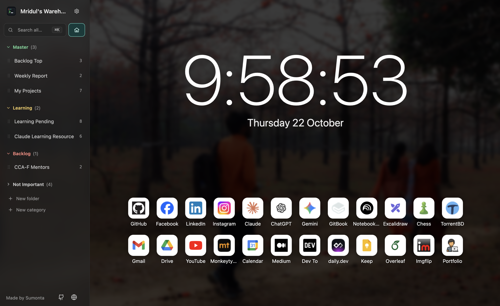
</p>

<p align="center">
  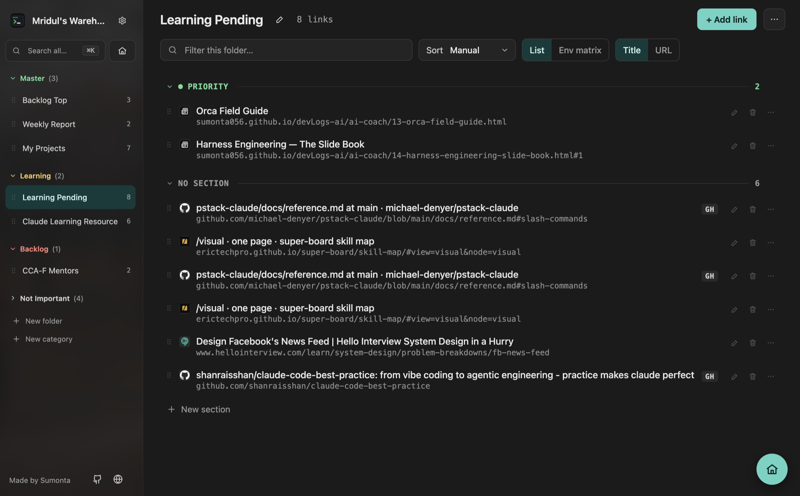
</p>

---

## Contents

- [Why Tab Warehouse](#why-tab-warehouse)
- [Features](#features)
- [Live demo](#live-demo)
- [Install](#install)
- [Quick start](#quick-start)
- [Keyboard shortcuts](#keyboard-shortcuts)
- [Privacy and permissions](#privacy-and-permissions)
- [How it works](#how-it-works)
- [Contributing](#contributing)
- [Tests](#tests)
- [Changelog](#changelog)
- [License](#license)

## Why Tab Warehouse

Developers keep the same page open in many versions: live, test, staging and `localhost`. Chrome's bookmark bar hides URLs and treats every link the same. Tab Warehouse fixes that:

- **Every URL in full.** Nothing is truncated, so you always see which host you are about to open.
- **Tags.** Each link gets a PROD, TEST, STAGE or LOCAL tag, or one of your own (QA, UAT …), from rules you write.
- **Tag matrix.** See the same page across all versions in one table, and jump from TEST to PROD in one click.
- **No lock-in.** Your links stay real Chrome bookmarks. They sync with your Google account and show in Chrome's bookmark manager. Uninstall the extension and nothing is lost.

## Features

### Home

- Opens on every new tab: a large clock, the date and your link tiles.
- Tiles are a normal bookmark folder called _Home_ in _Other bookmarks_, created empty on first start. Add your own links in Settings › Home page.
- Drag tiles to reorder. Right-click a tile to change its icon (upload or URL), edit it, open it in a new tab or remove it (with undo).
- Official icons for Google apps (Gmail, Drive, Calendar, Keep, Meet, Docs, Sheets, Slides, Forms); Chrome's favicon for everything else; on Home, Google's favicon service when Chrome has none, then a letter.
- Background image, darkness, blur, color, clock size, 12/24-hour, seconds, icon size and icons per row — all with a live preview.

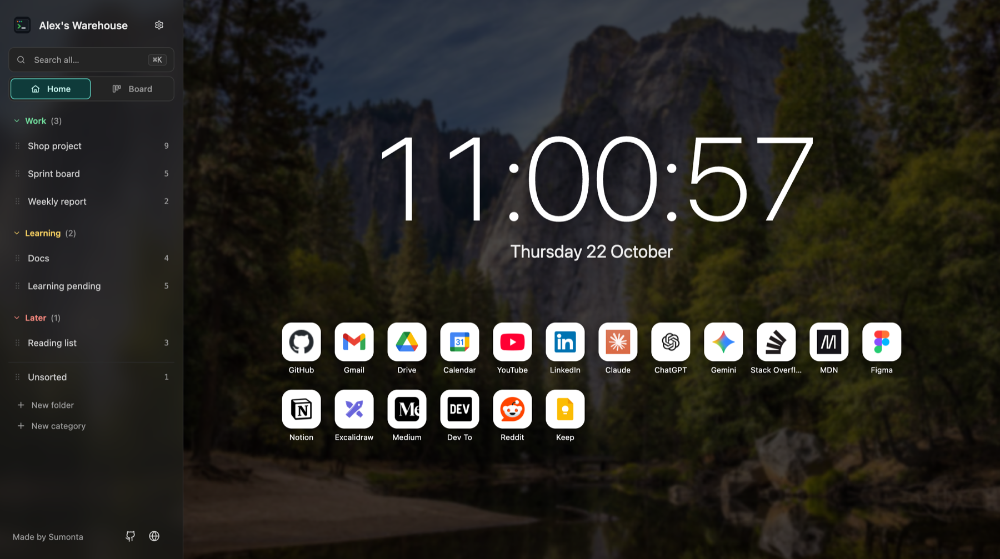

### Sidebar

- A full-width search box with **Home** and **Board** tabs under it.
- One entry per folder under your root folder, with link counts.
- Drag folders into your own order. The order is saved in the extension; Chrome's tree is never reordered.
- **Categories** group folders (for example "Daily" and "Rarely used"), with colors, collapse and drag reorder.
- Drop a link on a folder to move it there, or on the Home button to add it to Home.
- Resizable (180–440 px) and themeable: a solid color or a blurred copy of your Home background.

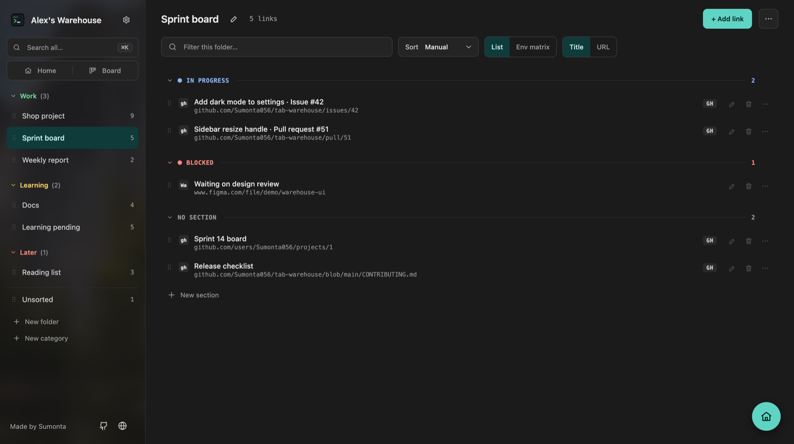

### Board

- The **Board** tab next to Home shows every folder as a column of cards, side by side, grouped into lanes by category (or in one row).
- Each card has the favicon, title, full URL and env badge. Folders with sections show them as small headers inside the column.
- Drag cards between columns or onto a section header to move them, or within a column to reorder (Manual sort). Drag a column header to change the folder order.
- Add a link at the bottom of any column, delete one with undo, and filter every column at once.

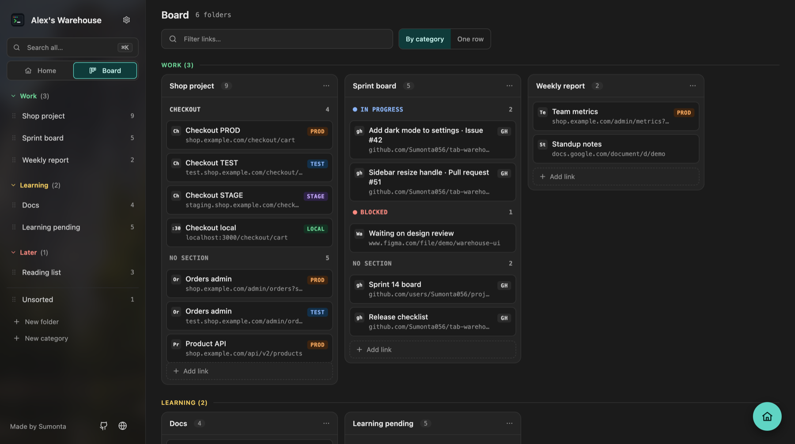

### Folder page

- Full URLs that wrap instead of truncating. Show the title first or the URL first.
- Sort per folder: manual, name, URL, tag, date added or host.
- **Sections**: split a folder into groups such as "In progress" or "Blocked". Each section is a real subfolder, so it syncs too.
- Inline edit, right-click menus, a folder filter, _Open all_ and _Copy all URLs_.
- Delete a link and undo it within 8 seconds.

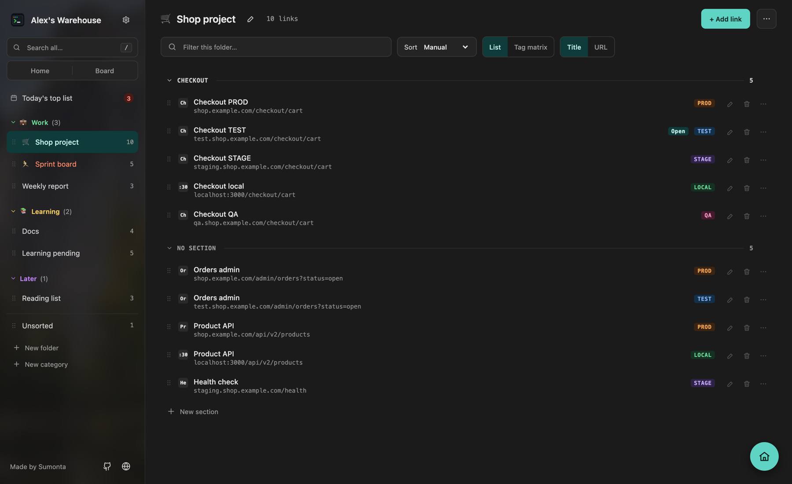

### Notes and priority

- Give a link a short note (up to 200 characters) and a priority: High, Medium or Low. Set them in the popup when you save, in the edit form, or from the row menu.
- Priority links come first, under **High**, **Medium** and **Low** headers, with a colored stripe. Your sort still applies inside each group. In folders with sections, priority links go first inside each section.
- Filter buttons: High, Medium, Low or Has note. The folder filter and search also find the text in your notes.
- Drop a link on a priority header to give it that priority.
- Notes stay on this computer. Backup › Export JSON includes them.

### Due dates

- Give a link a due date, with a time if you want one. Set it in the popup when you save (press **Due**), in the edit form, or from the row menu.
- Overdue links show a red chip. The **Overdue** and **Has due date** filter buttons find them.
- **Schedule** (the third tab under the search box) lists every link with a due date from all folders: Overdue, Today, Next 7 days and Later, the oldest overdue link first. Each row shows its folder.
- The due chip sits on the right of the row, so the dates line up.
- Turn on **Also add to Google Calendar** to open a filled-in Google Calendar event after you save. Google sends the reminder. The extension asks for no extra permission.

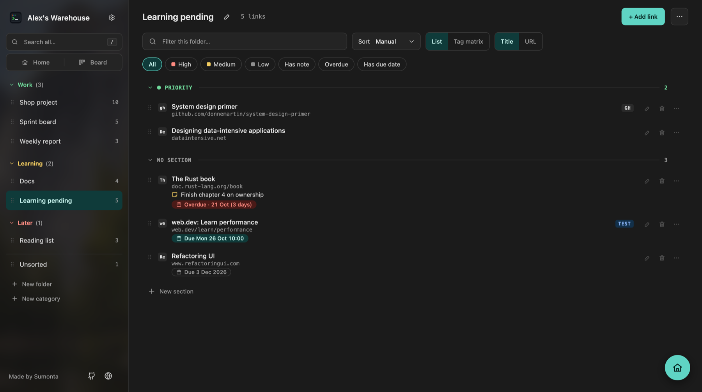

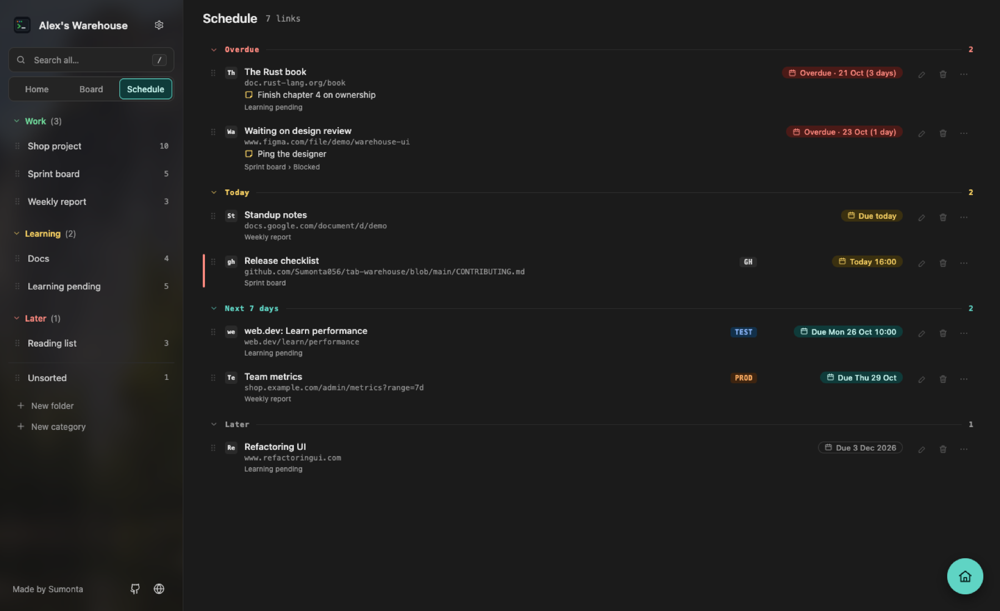

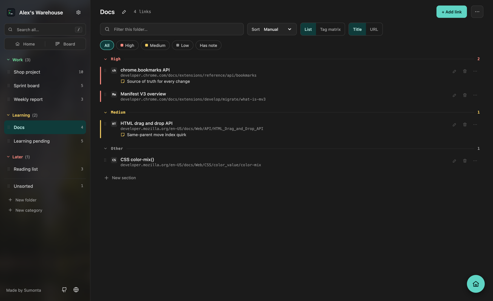

### Tags

- **Your tags**: add your own tags, such as QA, UAT or DEMO, next to the built-in PROD, TEST, STAGE and LOCAL. Pick one of 6 colors.
- **Tags by address**: "if the address contains `-test.` give the tag TEST". The first matching rule wins. Without rules, words like PROD or TEST in the title still work.
- **Same site in each version**: list the hosts of a site once, one box per tag. Every link then offers _Open on TEST / PROD / …_.
- **Tag matrix** view: one row per page, one column per tag. Empty cells offer **+ derive**.
- A **Try it** box explains which rule matches a link and why. Copy both lists as text and paste them on another machine.

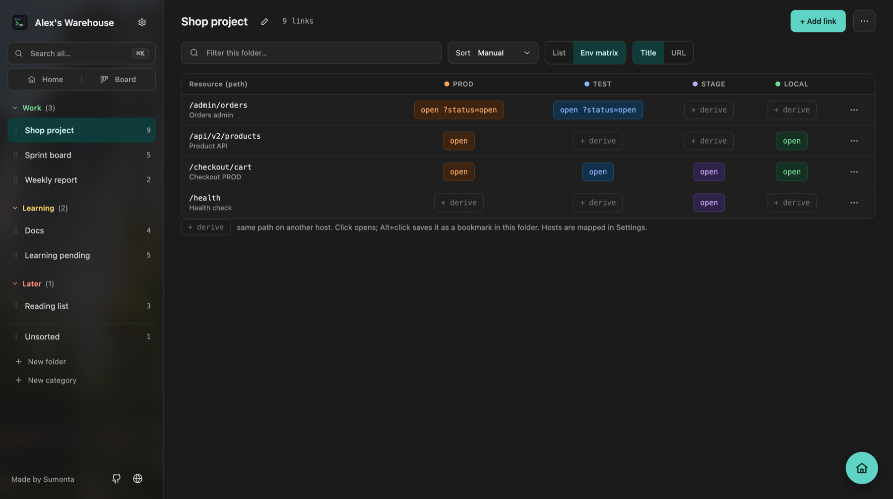

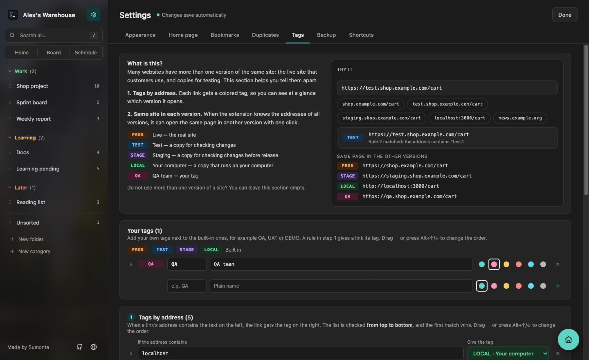

### Search and command palette

- `⌘⇧K` / `Ctrl+Shift+K` on a Tab Warehouse tab opens the command palette (change the key at `chrome://extensions/shortcuts`). It finds links, folders and Settings tabs by title, address, folder, note or tag.
- `Enter` opens the link in this tab, `⌘Enter` in a background tab.
- `/` searches every folder from the sidebar box.
- Type `tw` and a space in Chrome's address bar to search your links from any tab.

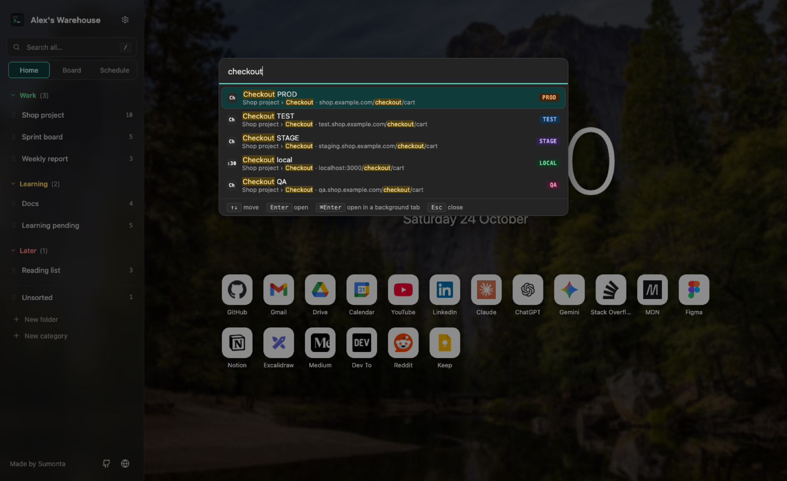

### Popup (`⌘⇧B` / `Ctrl+Shift+B`)

- Save the current tab into any folder, or create a new folder by typing its name.
- Save the full page or the whole site (`origin/`).
- Shows the tag and remembers the last folder.
- Warns in orange when the page is already saved, also when only `?utm_…`, `#part` or a trailing `/` differ, and shows where. **Save again** still saves a second copy.
- **Quick save** (`⌘K` / `Ctrl+K`): saves the tab into the last folder you saved to (or the root) without opening the popup. The toolbar icon shows a green ✓ for 2.5 s. If the page is already saved, nothing is saved and the popup opens with the warning.
- **Open this page in**: opens the same page in your other versions (from _Same site in each version_).
- Add a priority and a short note before you save.

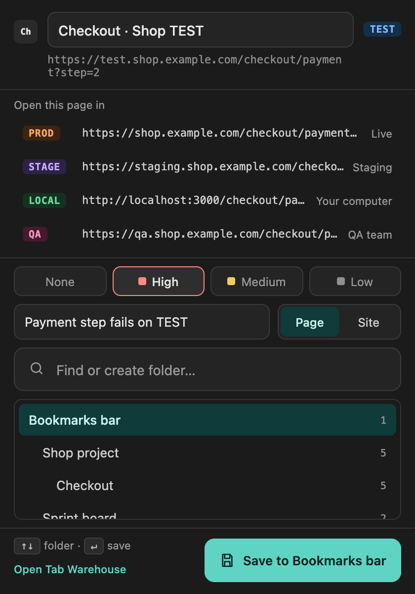

### Settings and backup

- One Settings view with 7 tabs: Appearance, Home page, Bookmarks, Duplicates, Tags, Backup, Shortcuts.
- **Shortcuts** shows the keys Chrome gives the extension (or _Not set_), the `tw` address bar keyword and the fixed keys of the page. **Change shortcuts** opens Chrome's shortcuts page, because Chrome does not let an extension change its own keys.
- **Duplicates** lists links saved more than once. Keep one copy; the others are deleted with Undo.
- Every change saves at once. There is no Save button.
- Text size for the sidebar, the page and the Board (80–140 %).
- Export to JSON (links, sections, sidebar order, categories and preferences) or to HTML (Chrome's bookmark format). Import merges and skips URLs you already have.

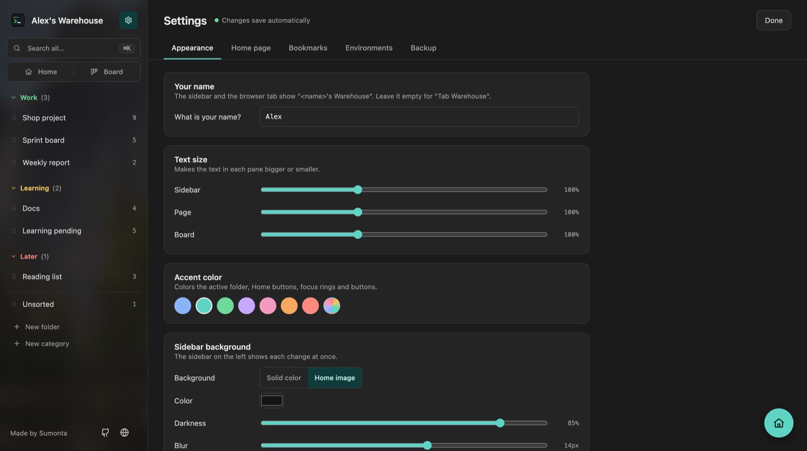

## Live demo

Try the real extension in your browser, with sample bookmarks and nothing to install: **[https://sumonta056.github.io/tab-warehouse/#demo](https://sumonta056.github.io/tab-warehouse/#demo)**.

The website and the demo live in [`site/`](site/). The demo loads the extension's own `newtab.html` and `popup.html` with a fake `chrome.*` API ([`site/demo/demo-chrome.js`](site/demo/demo-chrome.js)), so nothing is saved. The [Pages workflow](.github/workflows/pages.yml) builds and deploys the site after CI passes on `main`. To preview it locally:

```sh
./site/build.sh && python3 -I tests/serve.py 8811 _site
# then open http://127.0.0.1:8811/
```

## Install

### Download (recommended)

1. Download the latest ZIP from **[Releases](https://github.com/Sumonta056/tab-warehouse/releases/latest)** and unzip it. Move the folder to a place where it can stay, for example Documents.
2. Open `chrome://extensions` and turn on **Developer mode** (top right).
3. Click **Load unpacked** and choose the unzipped folder (the one that contains `manifest.json`).
4. Open a new tab. If Chrome asks, click **Keep it**. Then open ⚙ Settings to add your name, your Home sites and your root folder.

**Update:** download the new ZIP, replace the old folder, then click ↻ on the extension card. Your bookmarks and settings stay.

### From source

```sh
git clone https://github.com/Sumonta056/tab-warehouse.git
```

Load the `extension` folder of the clone with **Load unpacked**. After a `git pull`, click ↻ on the extension card.

### Chrome Web Store

Coming soon.

## Quick start

1. **Pick your root folder.** Open ⚙ Settings → Bookmarks. Its subfolders become the sidebar. By default it uses your bookmarks bar.
2. **Add tags by address.** Settings → Tags → Tags by address. For example: `localhost` → LOCAL, `-test.` → TEST, `-stage.` → STAGE.
3. **Link your versions.** Settings → Tags → Same site in each version. Add one row per site with its PROD, TEST, STAGE and LOCAL hosts.
4. **Save a page.** On any site, press `⌘⇧B` (macOS) or `Ctrl+Shift+B` (Windows/Linux), pick a folder and press Enter.
5. **Open the tag matrix.** Open a folder and choose View → **Tag matrix**.

## Keyboard shortcuts

| Keys                              | Action                                          |
| --------------------------------- | ----------------------------------------------- |
| `⌘⇧B` / `Ctrl+Shift+B`            | Open the save popup                             |
| `⌘K` / `Ctrl+K`                   | Quick save the tab without the popup            |
| `⌘⇧K` / `Ctrl+Shift+K`            | Open the command palette (on Tab Warehouse)     |
| `⌘Enter` (in the palette)         | Open the link in a background tab               |
| `tw` + space (in the address bar) | Search all folders from the address bar         |
| `/`                               | Search all folders                              |
| `Enter` (in search)               | Open the first result                           |
| `Esc`                             | Clear search or filter; close Settings          |
| `j` / `k`                         | Next / previous: Home, Board, Schedule, folders |
| `Alt+↑` / `Alt+↓`                 | Move the focused folder or section up / down    |
| `←` / `→` (on the sidebar edge)   | Resize the sidebar by 16 px                     |
| `←` / `→` (in Settings)           | Next / previous tab                             |
| `↑` / `↓`, `Enter` (in the popup) | Pick a folder, save                             |

Settings › Shortcuts lists these keys. To change the Chrome keys, click **Change shortcuts** there (it opens `chrome://extensions/shortcuts`).

Change `⌘⇧B`, `⌘K` and `⌘⇧K` at `chrome://extensions/shortcuts`. An install that is already there keeps its old keys after an update: set them there, or paste `tools/set-shortcuts.js` into the Console of that page. Chrome skips a suggested key that another extension already uses; then the shortcut shows as not set until you pick one there.

`⌘K` / `Ctrl+K` quick saves on any page. Many sites (GitHub, Slack, Notion) use `⌘K` themselves and lose it while the extension has it; if you want it back there, set another key or none. On Windows Chrome may keep `Ctrl+K` for itself; then the shortcut shows as not set and you can pick a key at `chrome://extensions/shortcuts`.

## Privacy and permissions

Tab Warehouse has no server, no account, no analytics and no tracking. It does not send your bookmarks anywhere.

- Links, titles and folders stay in **Chrome's bookmarks**.
- Preferences (sidebar order, categories, env rules, Home look) and link notes stay in **`chrome.storage.local`** on your machine. Chrome sync does not copy them.
- The only images loaded from the network are the official Google app icons (from `ssl.gstatic.com`), any icon URL you add yourself, and the icon of a Home link that Chrome has no icon for. For that last case the extension asks Google's favicon service (`www.google.com/s2/favicons`) and sends it only the host name of that link. Local addresses (localhost, IP addresses) are never sent.

| Permission  | Why it is needed                                                                    |
| ----------- | ----------------------------------------------------------------------------------- |
| `bookmarks` | Read and edit your bookmarks — the core of the extension                            |
| `storage`   | Save sidebar order, per-folder preferences, env rules, link notes and the Home look |
| `favicon`   | Show site icons from Chrome's own favicon cache                                     |
| `activeTab` | Read the current tab's title and URL, only when you open the popup or quick save    |

The extension has a background service worker (`background.js`) only for the address bar search (`tw`), quick save (`⌘K`) and the palette key (`⌘⇧K`, so it also works while the address bar has focus). It reads your bookmarks on each keystroke or key press and keeps nothing. The `omnibox` key is not a permission and shows no install warning.

## How it works

Tab Warehouse is plain JavaScript with ES modules. There is no framework, no bundler, no runtime dependency and no build step. npm is used only for dev tools (Husky, Prettier, commitlint).

- **Chrome's bookmarks are the source of truth.** The extension never caches titles or URLs. Every change calls `chrome.bookmarks`, and the page re-renders from `chrome.bookmarks.getTree()` when Chrome reports a change.
- **Extension-only data** (sidebar order, categories, env rules, Home look) lives in `chrome.storage.local`.
- **Sections are real subfolders**, so they survive an uninstall and sync with Chrome.

```
extension/             Everything Chrome loads (choose this folder in Load unpacked)
  manifest.json        Manifest V3: new tab override, popup, ⌘⇧B, ⌘K and ⌘⇧K commands
  newtab.html/.css/.js The main page: sidebar + folder page
  popup.html/.js       Toolbar popup: save the current tab
  constants/           Fixed values: envs, tags, sorts, themes, limits, defaults
  domain/              Pure logic: env detection, derive, sort, matrix, search, due dates, backup
  services/            The only code that calls Chrome APIs: storage, bookmarks, tabs, omnibox, favicons, import
  ui/                  Shared DOM pieces: h() helper, toast, menu, badges, icons, pickers, export
  state/               Shared page state and the actions that save it
  views/               One folder per screen: sidebar, folder, search, schedule, board, home, palette, settings, popup
  styles/              Design tokens and shared components
  icons/               Extension icons (source: icons/logo.svg)
tools/make-icons.py    Build the icon sizes from any logo
tools/package.sh       Build the release ZIP from extension/ (--store: Web Store ZIP)
tests/                 Unit, end-to-end and performance tests
site/                  Website, live demo and screenshots (deployed to GitHub Pages)
docs/                  Notes and requirements
```

The full behaviour spec is in [`.claude/rules/business-logic.md`](.claude/rules/business-logic.md). Every rule there has at least one test.

## Contributing

Contributions are welcome — bug reports, ideas and pull requests.

1. Read [CONTRIBUTING.md](CONTRIBUTING.md) for setup, code style and the pull request checklist.
2. Run `npm install` once. It installs Prettier and the git hooks that format, test and check your commit messages.
3. Look at the [open issues](https://github.com/Sumonta056/tab-warehouse/issues), or open a new one before a large change.
4. Run `./tests/run.sh` and make sure it is green before you open a pull request.

## Tests

No dependencies: Node's built-in test runner and headless Chrome.

```sh
./tests/run.sh             # syntax check + unit tests + end-to-end scenarios
./tests/run.sh popup       # only e2e scenarios whose name contains "popup"
node tests/perf/memprobe.mjs   # RAM, leak and render-speed check on the real extension
```

The e2e runner loads the real `extension/newtab.html` and `extension/popup.html` with a fake `chrome.*` API, so tests never touch your bookmarks. To watch a scenario run:

```sh
python3 -I tests/serve.py 8799
# then open http://127.0.0.1:8799/tests/e2e/runner.html?only=<name>
```

## Changelog

- **2.5.0** — Due dates on links with an optional Google Calendar event; quick save (`⌘K` / `Ctrl+K`) without the popup; the popup warns when a page is already saved and offers **Save again**; Settings › Shortcuts; the command palette moves to `⌘⇧K` / `Ctrl+Shift+K`. Details in [CHANGELOG.md](CHANGELOG.md).
- **2.4.0** — Full history in [CHANGELOG.md](CHANGELOG.md).
  - Command palette (⌘K) and `tw` search from the address bar.
  - Link notes and priority, a duplicate finder and your own tags (QA, UAT …).
  - Popup: open this page in your other versions; **Save** always visible.
- **2.3.0**
  - Board view: every folder as a column of cards, grouped by category or in one row, with drag to move and reorder, add, delete with undo and a filter.
  - Website with a live demo, and a release ZIP to download.
  - Shipped files now live in `extension/`.
- **2.2.0**
  - New installs start without built-in links; your name as the brand and a credit footer.
  - Home: no _Add link_ tile, space-above-tiles setting, missing icons fixed.
  - Delete button on each link row; text size sliders for the sidebar and the page.
  - Renamed to **Tab Warehouse** with a new terminal-style icon.
  - Home page: clock, date, your own tiles, background, clock and tile settings, official Google icons.
  - One Settings view with 5 tabs, auto-save, accent themes and a sidebar background.
  - Environments: plain-language labels and site rows, _Try it_, copy and paste; no default rules.
  - Resizable sidebar; categories with colors and drag reorder; sections inside folders; save-current-tab popup.
  - Fixes: edit form Save, category menu after a settings change, _Whole site_ only for http(s).
- **2.1.0** — Rename folders from the sidebar and page header; ✎ and ··· always visible on rows; right-click menus; import and export (JSON with preferences, Netscape HTML); `tools/make-icons.py`.
- **2.0.1** — Sidebar drag fixed; Alt+↑/↓ keyboard reorder; Unsorted always listed last.
- **2.0.0** — Sidebar and folder page replace the column board. Six sort modes, env matrix with derive, per-folder view settings, reorderable sidebar, global search, host map.
- **1.0.0** — Column board, popup search.

## License

[MIT](LICENSE) © 2026 Sumonta Saha Mridul
