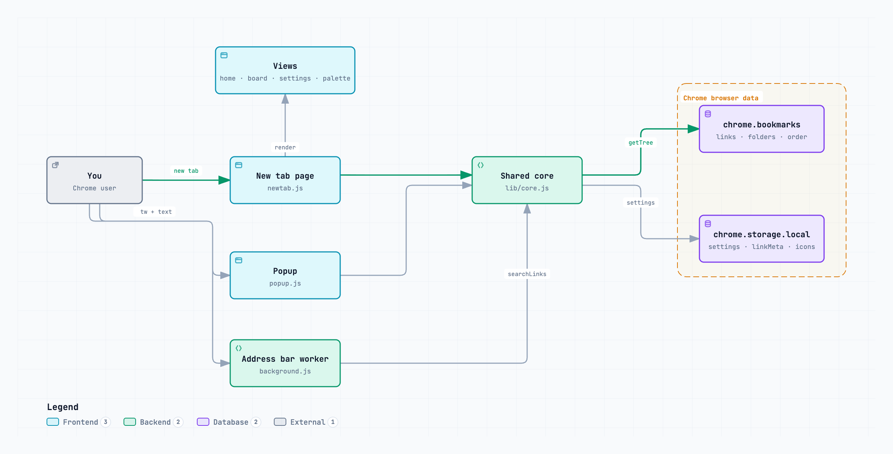

# Architecture

Tab Warehouse has three entry points. All three use one shared module, and that module talks to two Chrome stores.

## Entry points

| Entry point        | File                      | What it does                                                                                                      |
| ------------------ | ------------------------- | ----------------------------------------------------------------------------------------------------------------- |
| New tab page       | `extension/newtab.js`     | The main page: sidebar and folder page. Sends each view to `home.js`, `board.js`, `settings.js` and `palette.js`. |
| Popup              | `extension/popup.js`      | Saves the current tab into a folder (⌘⇧B).                                                                        |
| Address bar worker | `extension/background.js` | Searches links from the address bar with the keyword `tw`.                                                        |

## Shared core

`extension/lib/core.js` holds the logic that every page uses: the `h()` DOM helper, sorting, tag detection, `searchLinks()`, and loading and saving settings. `extension/lib/transfer.js` adds backup export and import.

## Stores

| Store                  | Holds                                                                                       |
| ---------------------- | ------------------------------------------------------------------------------------------- |
| `chrome.bookmarks`     | Titles, URLs, folders and order. The source of truth; never copied.                         |
| `chrome.storage.local` | Settings, sidebar order, tags, link notes (`linkMeta`), Home icons and the Home background. |

## Data flow

- **Read:** a new tab calls `refresh()`, which reads `chrome.bookmarks.getTree()` and draws the page again with `h()`.
- **Write:** every edit calls the `chrome.bookmarks` API. Chrome fires `onCreated`, `onChanged`, `onMoved` and the other bookmark events. The page waits 30 ms for more events, then runs `refresh()` once.
- **Rule:** bookmark data goes in `chrome.bookmarks`. Data that is only for the extension goes in `chrome.storage.local`.

The full behaviour spec is `.claude/rules/business-logic.md`.
